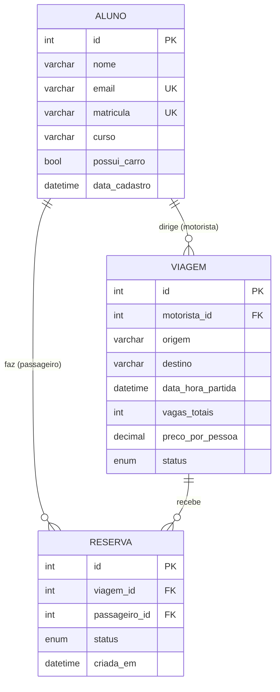

# Caronas Universitárias API

https://youtu.be/Wz66HFIgBBY

API REST para organizar caronas entre alunos da faculdade. Um aluno pode oferecer viagens como motorista e também reservar vagas como passageiro.

Projeto da disciplina **Megadados** (Insper), desenvolvido com **FastAPI**, **SQLModel** (ORM) e **MySQL**.

## Funcionalidades

- **Alunos**: cadastro, consulta, atualização e remoção de alunos. E-mail e matrícula são únicos.
- **Viagens**: um aluno cadastra uma viagem como motorista, informando origem, destino, horário de partida, número de vagas e preço por pessoa. A viagem tem um status (`agendada`, `em_andamento`, `concluida`, `cancelada`).
- **Reservas**: um aluno reserva uma vaga em uma viagem como passageiro. A reserva pode ser `confirmada` ou `cancelada`, e um aluno não pode reservar duas vezes a mesma viagem.

Ao remover um aluno, as viagens e reservas dele também são removidas. Ao remover uma viagem, as reservas dela também são removidas.

## Modelo relacional



## Endpoints

| Método | Rota | Descrição |
|--------|------|-----------|
| `POST` | `/alunos` | Cadastra um aluno |
| `GET` | `/alunos` | Lista os alunos (filtro opcional por `curso`) |
| `GET` | `/alunos/{id}` | Consulta um aluno |
| `PATCH` | `/alunos/{id}` | Atualiza dados de um aluno |
| `DELETE` | `/alunos/{id}` | Remove um aluno |
| `POST` | `/viagens` | Cadastra uma viagem |
| `GET` | `/viagens` | Lista as viagens por horário de partida (filtros opcionais por `status` e `motorista_id`) |
| `GET` | `/viagens/{id}` | Consulta uma viagem |
| `PATCH` | `/viagens/{id}` | Atualiza uma viagem, inclusive o status |
| `DELETE` | `/viagens/{id}` | Remove uma viagem |
| `POST` | `/reservas` | Reserva uma vaga em uma viagem |
| `GET` | `/reservas` | Lista as reservas (filtros opcionais por `viagem_id`, `passageiro_id` e `status`) |
| `GET` | `/reservas/{id}` | Consulta uma reserva |
| `PATCH` | `/reservas/{id}` | Altera o status de uma reserva |
| `DELETE` | `/reservas/{id}` | Remove uma reserva |

Todas as listagens aceitam paginação com `offset` e `limit`.

A documentação interativa fica em `http://localhost:8000/docs` com a API rodando.

## Estrutura do projeto

```
.
├── app/
│   ├── main.py          # Criação da aplicação FastAPI e registro das rotas
│   ├── config.py        # Leitura das variáveis de ambiente (.env)
│   ├── database.py      # Conexão com o MySQL e sessão do ORM
│   ├── models/          # Modelos SQLModel: tabelas e schemas de entrada/saída
│   └── routers/         # Rotas de alunos, viagens e reservas
├── .env.example         # Modelo das variáveis de ambiente
├── requirements.txt
└── README.md
```

## Como executar

1. Crie e ative um ambiente virtual e instale as dependências:

   ```bash
   python3 -m venv .venv
   source .venv/bin/activate
   pip install -r requirements.txt
   ```

2. Crie o banco no MySQL:

   ```sql
   CREATE DATABASE caronas;
   ```

3. Copie `.env.example` para `.env` e preencha com suas credenciais do MySQL.

4. Inicie a API:

   ```bash
   fastapi dev app/main.py
   ```
